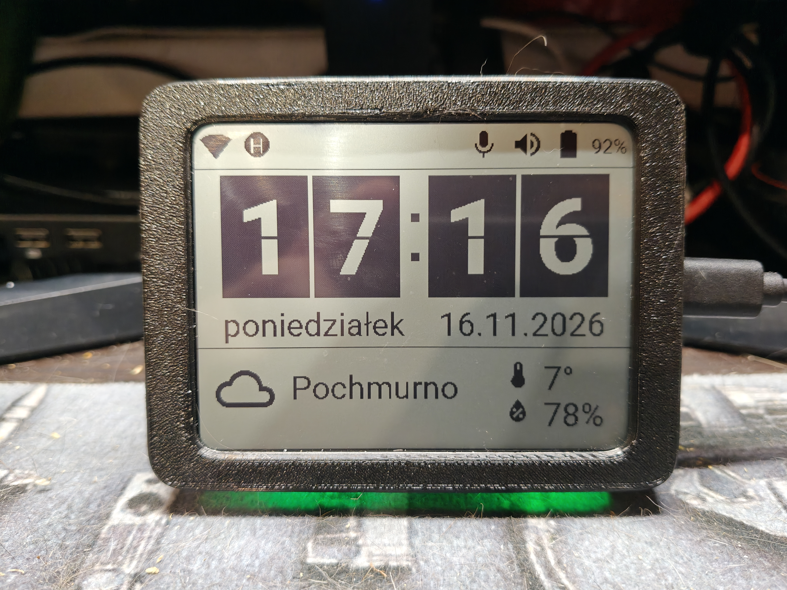

# Waveshare ESP32-S3-RLCD-4.2 - Voice Assistant Satellite

[](https://esphome.io)
[](https://www.waveshare.com)
[](LICENSE)

An optimized, production-grade **Voice Assistant Satellite** and desktop information hub for **Home Assistant**, built on the **Waveshare ESP32-S3-RLCD-4.2** development board.



> [!NOTE]
> **Video Demonstration:** A 4.5-minute real-world video demo showcasing wake-word detection, conversational context, and LLM dialogue handling is available in [GitHub Release v1.0.0](https://github.com/hookmt/waveshare-esp32-s3-rlcd-4.2/releases/tag/v1.0.0) or direct download: [rlcd_voice_demo.mp4](https://github.com/hookmt/waveshare-esp32-s3-rlcd-4.2/releases/download/v1.0.0/rlcd_voice_demo.mp4).


---

## Highlights

* **Reflective Display (ST7305):** Ultra-crisp 400x300 monochrome RLCD display readable in ambient daylight with zero backlight glare.
* **Dual Microphones with Hardware AEC (ES7210):** Superior wake-word listening range and acoustic echo cancellation.
* **4-Pixel Addressable Status Halo (WS2812):** Downward-firing ambient LED bar displaying real-time smart home and voice states.
* **Audio Ducking & Media Player MUTE:** Automatically pauses or mutes paired room music streamers (such as **Spider**) when speaking.
* **18650 Battery Backup:** Built-in battery holder with calibrated voltage-to-percentage telemetry on GPIO4.
* **Custom 3D-Printed Stand & Enclosure:** Functional desktop enclosure with accessible tactile buttons (`KEY`, `PWR`, `BOOT`).

---

## System Ecosystem

This project is part of a coordinated hardware trio for Home Assistant:

```text
       +----------------------------------------------------+
       |              Home Assistant Server                 |
       +----------------------------------------------------+
              ^                         ^            ^
              |                         |            |
       [Assist Pipeline]           [Dashboard]  [Music Assistant]
              |                         |            |
              v                         v            v
     +-----------------+       +----------------+   +-------------------+
     |   RLCD 4.2"     | <---> |  Touch LCD 7C  |   |  Spider Streamer  |
     | Voice Satellite |  MUTE |  Touch Control |-->|  ESP32-S3 + DAC   |
     +-----------------+       +----------------+   +-------------------+
```

1. **RLCD 4.2" (This Repository):** Whisper-quiet, ambient bedside or desk voice satellite with flip-clock and weather display.
2. **Touch LCD 7C:** 7-inch central wall or bedside control hub for lights, scenes, and media (see [waveshare-esp32-s3-touch-lcd-7c](https://github.com/hookmt/waveshare-esp32-s3-touch-lcd-7c)).
3. **Spider Audio Receiver:** Dedicated Hi-Fi network audio streamer (ESP32-S3 + PCM5102A DAC) controlled via Music Assistant. When the RLCD detects speech, room music automatically ducks or mutes.

---

## 4-Pixel WS2812 Status Bar

The satellite features a custom 4-pixel WS2812 addressable LED strip mounted above the 18650 battery holder, illuminating the desk surface:

| Pixel | Monitored Subsystem | Color Signals |
|---|---|---|
| **Pixel 0** | **Home State** | Breathing Green (All OK), Flashing Amber (Attention needed), Solid Red (Alert/Error) |
| **Pixel 1** | **Voice Assistant** | Solid/Breathing Blue (Listening), Amber (Processing), Green (Speaking reply) |
| **Pixel 2** | **Doors & Alarms** | Cyan (Open door/window), Blink (Active timer or wake alarm) |
| **Pixel 3** | **Infrastructure** | Green (Network & HA Online), Amber (Degraded link), Red (HAOS connection lost) |

Detailed wiring and assembly instructions are available in the [Hardware Installation Guide](hardware/README.md).

---

## Key Technical Fixes in this Firmware

### 1. I2S Audio Bus Collision Resolution
The board shares the I2S digital audio bus between the ES7210 microphone ADC and the ES8311 speaker DAC. In standard implementations, immediate wake-word trigger chimes cause driver contention (`Parent bus is busy` or clipped chimes). 
* **Fix:** A sequenced pipeline plays the audio chime, waits 150 ms for buffer queuing, monitors `speaker.is_playing` until completion, introduces an 80 ms codec stabilization delay, and only then starts microphone capture.

### 2. High-Speed SPI (4 MHz) & Event-Driven Rendering
At the default 1 MHz SPI bus speed, transferring the 15 KB display buffer took over 180 ms, starving the CPU and causing `micro_wake_word: Not enough free bytes in ring buffer` errors.
* **Fix:** Accelerated SPI bus to 4 MHz and set `update_interval: never`. The display now refreshes strictly on event triggers (top-of-minute clock snap and HA state changes), dropping loop latency to ~50 ms.

### 3. Calibrated Battery Telemetry & 22-Hour Field Test
* **Field Test Results:** In real-world battery endurance testing, the satellite operated continuously for **22 hours and 6 minutes** on a single degraded 18650 cell (~2000 mAh real capacity) under normal room use (continuous wake-word listening, active voice dialogues, hourly display renders, and two full OTA firmware updates performed over battery).
* **Power Draw:** Average active current consumption is remarkably low: **~75 - 90 mA** (~0.35W).
* **Piecewise Linear Calibration:** Standard linear voltage-to-percentage mappings report inaccurate numbers near discharge cutoff. Based on recorded battery discharge logs, a calibrated 14-point piecewise linear filter maps raw ADC voltage (GPIO4 with 12 dB attenuation and 3.0x multiplier) into true battery capacity down to the 2.90V cutoff:
  ```yaml
  - calibrate_linear:
      method: exact
      datapoints:
        - 2.90 -> 0.0
        - 3.00 -> 1.0
        - 3.20 -> 7.0
        - 3.50 -> 25.0
        - 3.80 -> 60.0
        - 4.00 -> 85.0
        - 4.20 -> 100.0
  ```

---

## Repository Structure

```text
├── esphome/
│   ├── esp32_s3_rlcd_42_satellite.yaml  # Main ESPHome production configuration
│   └── secrets.yaml.example             # Wi-Fi and API credentials template
├── hardware/
│   ├── README.md                        # Step-by-step LED strip wiring walkthrough
│   └── *.jpg                            # Visual assembly reference photos
├── enclosure/
│   ├── README.md                        # 3D print parameters and orientation
│   ├── front_rlcd_modified.stl          # Front bezel frame
│   ├── front_rlcd_modified.blend        # Blender editable source file
│   ├── back_rlcd.step                   # Rear enclosure snap cover
│   └── buttons_rlcd.step                # Tactile push-button caps
├── firmware/
│   └── esp32_s3_rlcd_42_factory.bin     # Pre-compiled flashable factory binary
└── README.md
```

---

## Quick Start

### 1. Configure Credentials
Copy `esphome/secrets.yaml.example` to `esphome/secrets.yaml`:
```bash
cp esphome/secrets.yaml.example esphome/secrets.yaml
```
Fill in your local Wi-Fi SSID and password.

### 2. Flash via ESPHome
Connect the board via USB-C and compile:
```bash
esphome run esphome/esp32_s3_rlcd_42_satellite.yaml
```

Alternatively, write the pre-compiled binary in `firmware/` using `esptool.py` or the web browser ESP Web Tools flasher.

---

## 🇵🇱 Dokumentacja i opis projektu (PL)

### Główne cechy
* **Ekran RLCD 4.2" (ST7305):** monochromatyczny wyświetlacz odbiciowy (~400×300), czytelny w świetle dziennym, całkowicie pozbawiony męczącego podświetlenia nocnego.
* **Podwójny mikrofon z procesorem echa AEC (ES7210):** sprzętowa eliminacja echa akustycznego i wysoka czułość nasłuchu słowa wybudzającego (*Alexa* / *Okay Nabu*).
* **4 diody statusu WS2812 (efekt halo):** zamontowane nad koszykiem akumulatora, oświetlają blat stołu/szafki subtelną poświatą:
  * **Piksel 0 (Stan domu):** zielone oddychanie (OK), pulsujący bursztyn (uwaga), czerwony (błąd/alarm).
  * **Piksel 1 (Asystent VA):** niebieski (nasłuch), bursztyn (przetwarzanie zapytania), zielony (odpowiedź głosowa).
  * **Piksel 2 (Drzwi i alarmy):** turkus (otwarte drzwi/okno), miganie (aktywny minutnik lub budzik).
  * **Piksel 3 (Infrastruktura):** zielony (Home Assistant i sieć online), bursztyn (degradacja), czerwony (brak łączności).
* **Koordynacja z odtwarzaczami (MUTE / Audio Ducking):** podczas wykrycia mowy satelita automatycznie wycisza skojarzony w danym pokoju odtwarzacz muzyczny (**Spider** / Music Assistant).
* **Ponad 22 godziny pracy na akumulatorze 18650:** zmierzony średni pobór prądu pod obciążeniem to zaledwie ~75-90 mA (~0,35 W). Kalibracja 14-punktowa w ESPHome wiernie odzwierciedla stan rozładowania ogniwa Li-ion aż do progu 2,90 V.
* **Rozwiązany problem magistrali I2S:** wyeliminowano kolizję pomiędzy kodekiem audio ES8311 a mikrofonem ES7210 poprzez sekwencyjne odczekanie na zakończenie dzwonka wybudzenia przed aktywacją toru nagrywania.
* **Przyspieszenie SPI do 4 MHz:** transfer bufora 15 KB zajmuje zaledwie ~50 ms zamiast 180 ms, całkowicie likwidując błędy przepełnienia bufora kołowego słowa wybudzającego (`ring buffer`).

---

## License & Attribution

Designed and maintained by **hookmt** ([GitHub](https://github.com/hookmt)).
Open-source under the MIT License.
