# Hardware & LED Strip Installation Guide

This guide details the hardware modifications and assembly for the **Waveshare ESP32-S3-RLCD-4.2** Voice Assistant Satellite, specifically adding the **4x WS2812 addressable RGB LED status bar**.

---

## 1. Overview of Components

| Component | Description |
|---|---|
| **Base Board** | Waveshare ESP32-S3-RLCD-4.2 (ST7305 reflective display, ES7210 AEC dual mics, ES8311 codec, SHTC3 temp/humidity, PCF85063 RTC) |
| **Status LEDs** | 4-pixel strip of WS2812 addressable RGB LEDs (5V, GRB) |
| **Speaker** | 8Ω 2W micro speaker with 2-pin JST connector (plugged into `SPK` port) |
| **Battery** | Standard 18650 Li-ion cell (unprotected or protected flat-top/button-top) |
| **Internal Frame** | 3D-printed mounting bracket for speaker and cable management |
| **Enclosure** | 3D-printed front bezel, rear cover, and tactile buttons (`enclosure/`) |

---

## 2. Pinout & Electrical Connection

The 4x WS2812 LED strip connects directly to the 2x8 pin female header located on the back of the Waveshare PCB (next to the battery holder).

### 2x8 Header Pinout (Back View)

```text
       [ Battery Holder Top ]
  +-------------------------------+
  |  (3V3)  [1]   [2]  (VBUS)     |  <-- VBUS (+5V from USB)
  |  (GND)  [3]   [4]  (GND)      |  <-- GND (Ground)
  |  (GP0)  [5]   [6]  (GP19)     |
  |  (GP1)  [7]   [8]  (GP20)     |  <-- GP1 (WS2812 Data In)
  |  (GP2)  [9]  [10]  (TXD)      |
  |  (GP3) [11]  [12]  (RXD)      |
  | (GP17) [13]  [14]  (SDA)      |
  | (GP18) [15]  [16]  (SCL)      |
  +-------------------------------+
       [ ESP32-S3 Module Bottom ]
```

### Wiring Color Code

* **Red Wire (+5V)** -> Pin 2: **`VBUS`** (provides clean 5V power from USB-C)
* **Black Wire (GND)** -> Pin 4: **`GND`** (common ground)
* **Green Wire (Data In)** -> Pin 7: **`GP1`** (GPIO1 on ESP32-S3, drives WS2812 timing via RMT)

> [!TIP]
> The strip is powered from `VBUS` so it receives full 5V while running from USB-C. When running purely on 18650 battery (~3.7V - 4.2V), WS2812 continues to function smoothly.

---

## 3. Step-by-Step Assembly Walkthrough

### Step 1: Pre-assembly Testing
Verify the base display, WiFi, and sensors using the factory diagnostic firmware.
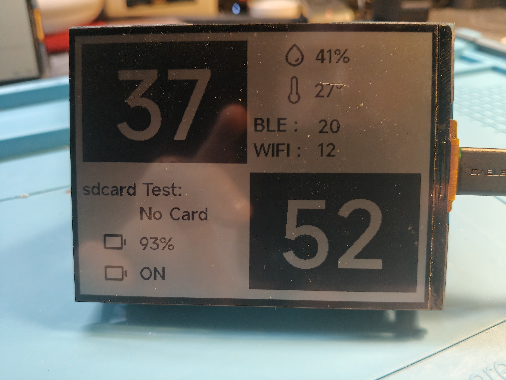

### Step 2: PCB Header Verification
Locate the 2x8 header and identify pins `VBUS`, `GND`, and `GP1`.
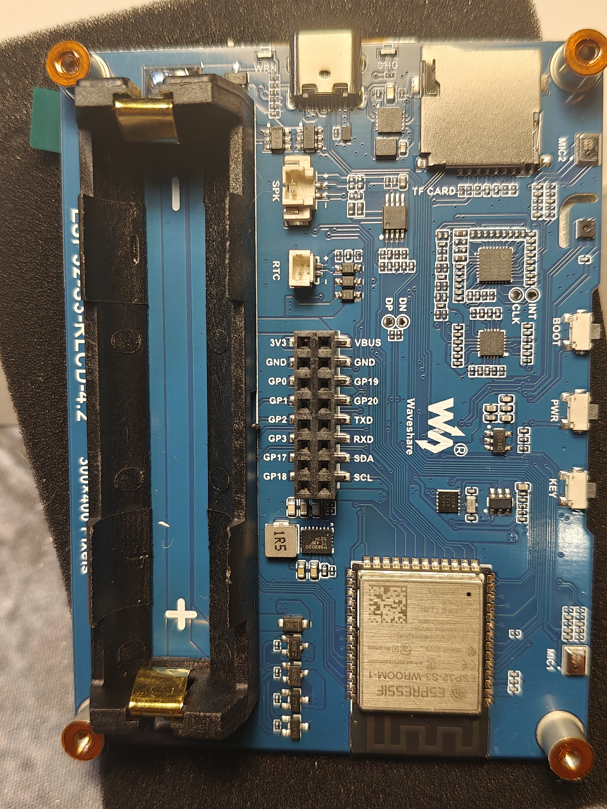

### Step 3: Prepare Parts
Prepare the 4-pixel WS2812 strip with pre-soldered wires (Red, Green, Black), the internal mounting frame, speaker, and RLCD board.
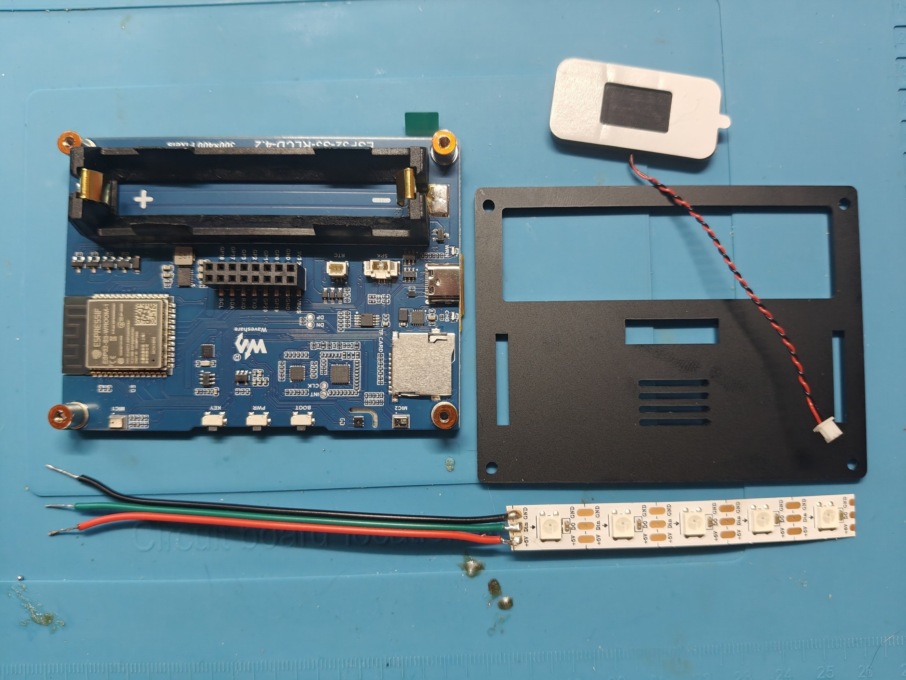

### Step 4: Mount LED Strip
Affix the 4-pixel strip along the top outer edge of the 18650 battery holder using thin double-sided adhesive tape.
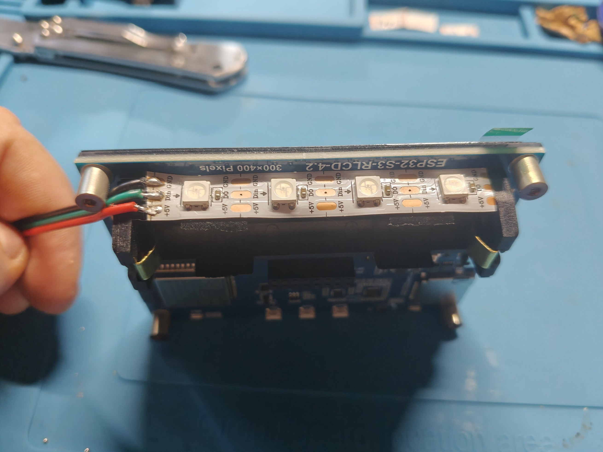

### Step 5: Route LED Wires
Route the three-wire cable neatly around the standoff towards the header opening.
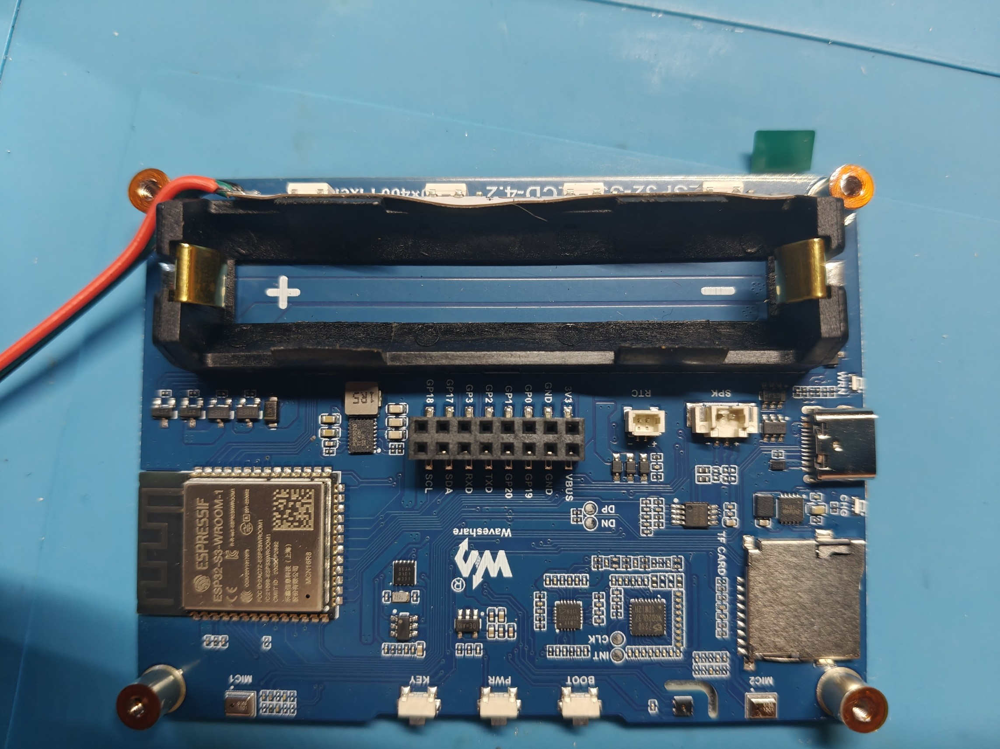

### Step 6: Install Speaker and Frame
Mount the speaker onto the internal 3D-printed frame and connect its 2-pin JST plug to the `SPK` header on the board.
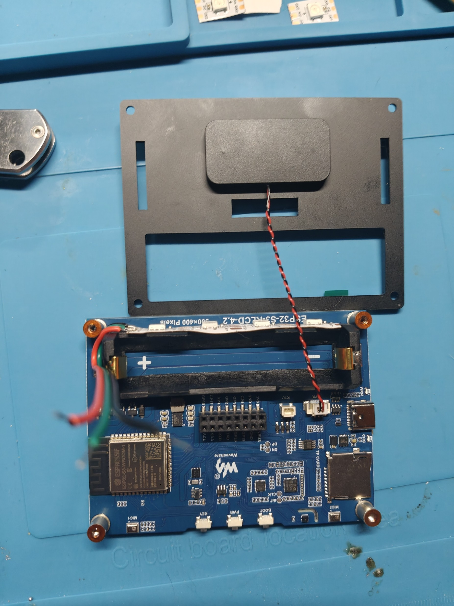

### Step 7: Header Connection Detail
Insert the crimped jumper pins into the 2x8 header:
- Red wire to `VBUS` (top right pin in header orientation)
- Black wire to `GND` (second pin on right)
- Green wire to `GP1` (fourth pin on left)
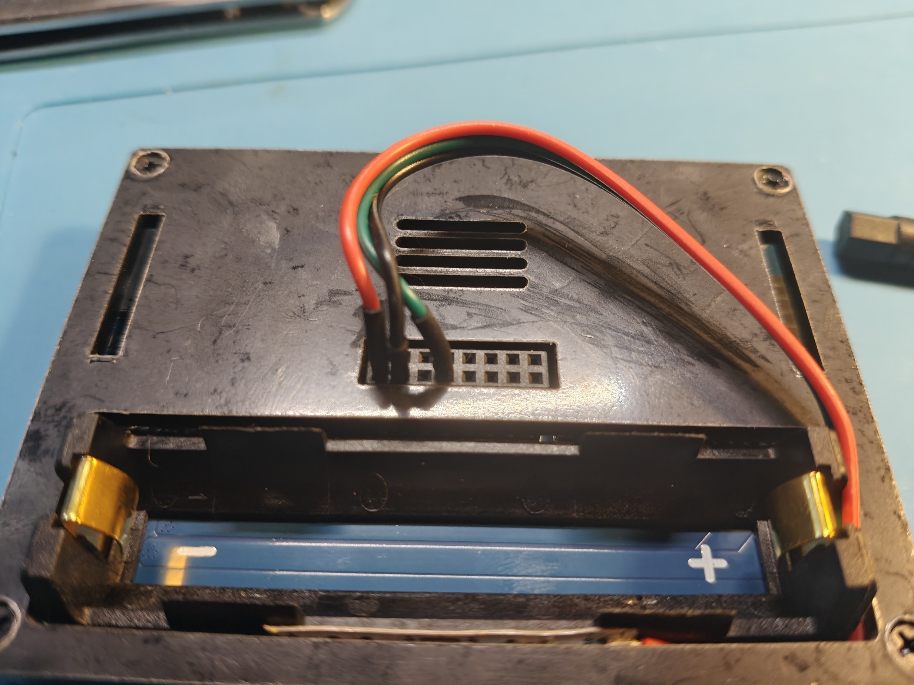

### Step 8: Battery Installation & Internal Wiring
Install the 18650 cell into the integrated holder. Secure the header wires neatly.
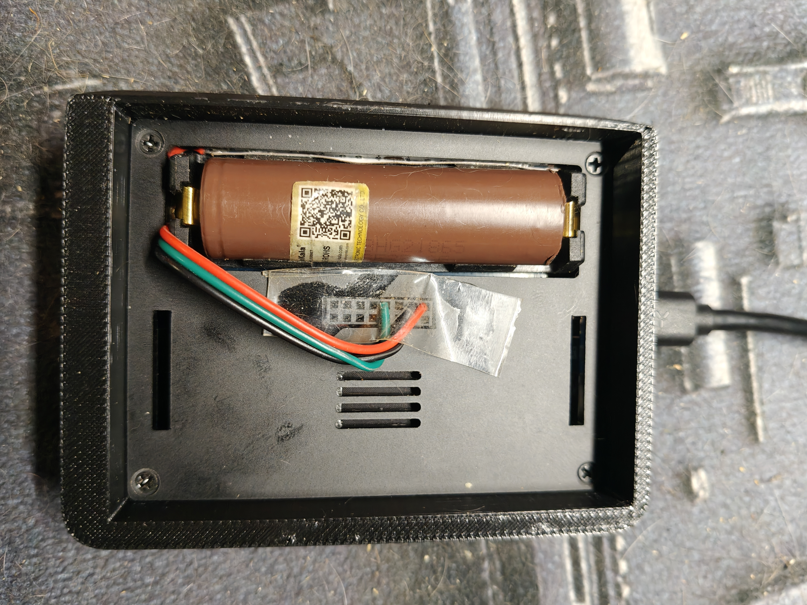

### Step 9: Final Assembly & Live Run
Assemble into the 3D-printed enclosure. The status LEDs illuminate downwards through the dedicated rear slot with an elegant halo reflection on the desk surface.
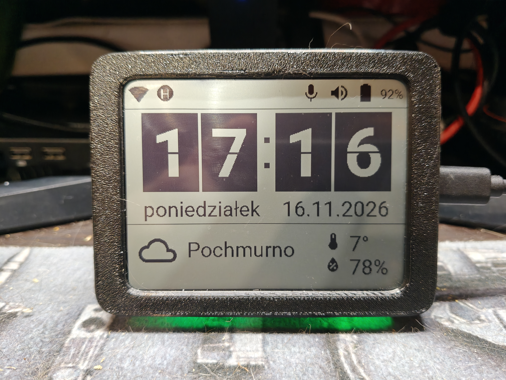
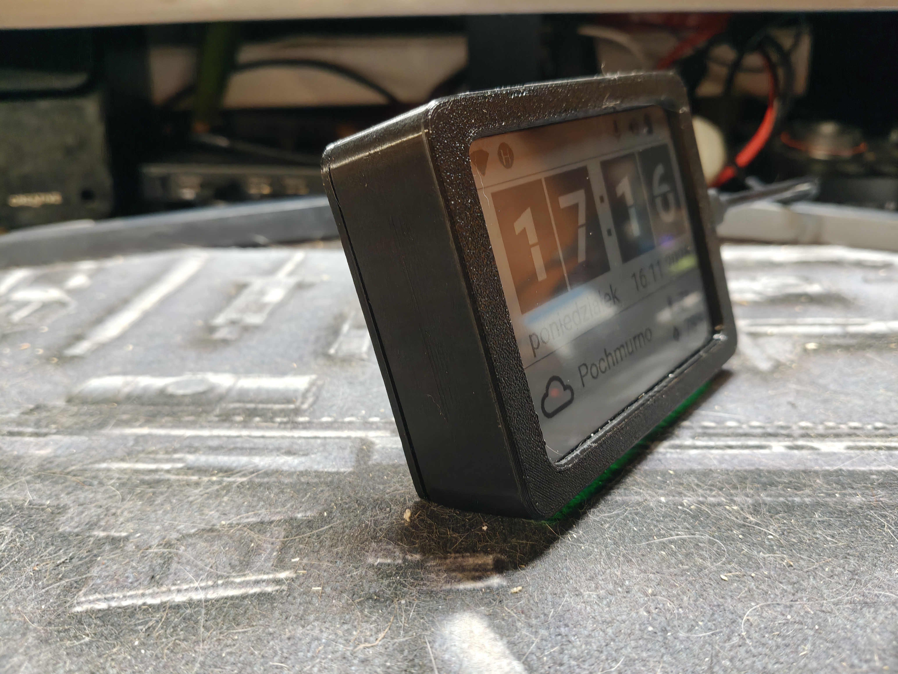
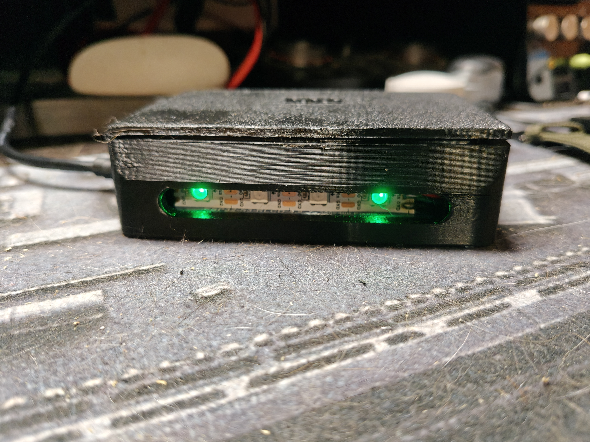
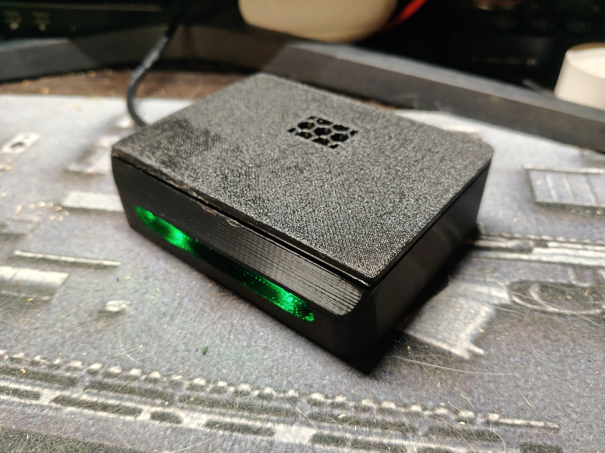

